<!--
  Tennici — organization profile README
  Lives at:  github.com/Tennici/.github  →  profile/README.md
  The SVGs (header, divider, services, skills, flow, footer) sit in the same profile/ folder.
  Absolute URLs are used on purpose: relative image paths are unreliable on org profile pages.
-->

<div align="center">




<br/>




</div>

## ◆ `tennici.yml`

```yaml
org:        Tennici
based_in:   Italy
what:       a small studio where software, hardware and design are one job, not three
we_do:
  - software & web development
  - electronics & embedded systems
  - brand identity, graphics & editorial design
  - video editing & post-production
skills:
  - computer science & software development
  - hardware & electronics
  - Adobe Creative Suite
  - collaborative workflow & version control
motto:      "Code, circuits and pixels: built by the same hands."
```

<div align="center"></div>

## ⚡ What we do

<div align="center">

</div>

<div align="center"></div>

## 🧠 Skills

<div align="center">

</div>

<div align="center"></div>

## 🔁 How we work

<div align="center">

</div>

```diff
+ One team from brief to delivery: the people who design it are the people who build it
+ Software and hardware designed together, not glued together at the end
+ Every pixel has a reason, every line of code has a review
! No hand-offs lost in translation, no mockups that never ship
```

<div align="center"></div>

## 👥 Crew

<div align="center">

<table>
<tr>
<td align="center" width="150">
<a href="https://github.com/Gabriele-Cortii"></a><br/>
<b>Gabriele Corti</b><br/>
<sub><a href="https://github.com/Gabriele-Cortii">@Gabriele-Cortii</a></sub>
</td>
<td align="center" width="150">
<a href="https://github.com/ahmeddolo"></a><br/>
<b>Ahmed Damouche</b><br/>
<sub><a href="https://github.com/ahmeddolo">@ahmeddolo</a></sub>
</td>
<td align="center" width="150">
<a href="https://github.com/andreaCederle"></a><br/>
<b>Andrea Cederle</b><br/>
<sub><a href="https://github.com/andreaCederle">@andreaCederle</a></sub>
</td>
<td align="center" width="150">
<a href="https://github.com/bertax29"></a><br/>
<b>Cristian Bertacchi</b><br/>
<sub><a href="https://github.com/bertax29">@bertax29</a></sub>
</td>
<td align="center" width="150">
<a href="https://github.com/gabrielepandiani"></a><br/>
<b>Gabriele Pandiani</b><br/>
<sub><a href="https://github.com/gabrielepandiani">@gabrielepandiani</a></sub>
</td>
</tr>
</table>

</div>

<div align="center"></div>

## 📫 Let's build something

<div align="center">

<a href="mailto:gabri08.corti@gmail.com">
  
</a>

<br/><br/>

<sub><b>Got something that needs to work <i>and</i> look good?</b><br/>Software, hardware or both: that's exactly our kind of project.</sub>

<br/><br/>



</div>
